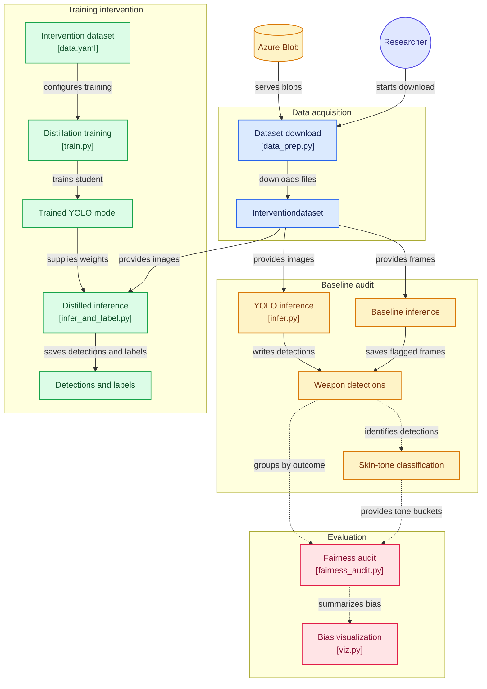

## Project Abstract
Automated Violence Detection Systems (AVDS) are increasingly deployed in sensitive environments (schools, policing), operating on the assumption that object detection algorithms are objective. However, industry-standard models (e.g., YOLOv8) are suspected of disproportionately misclassifying
darker-skinned individuals as armed. This bias stems from "underestimation bias"[1] (unrepresentative training data) and "negative legacy"[1] (subjective labeling of aggressive behavior). While current research focuses on detecting weapons,
this project introduces an intervention: Object Discrimination Training. We investigate if explicitly training models on "confusing objects" (phones, wallets) held by diverse hands reduces False Positives more effectively than standard binary (weapon/no-weapon) training.

## Research Questions
How do historical data labeling practices in standard datasets (UCF-Crime) encode algorithmic bias into the baseline model
Does adding a “Non-Weapon” class filter (trained on diverse hands holding common non weapon objects) increase reliability more than just having weapon classes?

## Tools & Tech Stack
Object Detection Models:
 YOLOv8 (You Only Look Once, Version 8) 
It’s commonly cited in research papers relating to weapon detection (3000+) serving as a solid benchmark for industry grade models.

RT-DETR (Real Time Detection Transformer)
Designed to understand global context (the entire scene) better than most CNNs.

 SSD MobileNet
Quantized model (shrunken models) designed to run on the camera rather than a server.  

Skin Tone Analysis/Clustering: OpenCV + Monk SkinTone Examples (MST-F) Dataset
Currently has the most representative range of skin tones in relation to computational tasks. Is effective in detecting skin tones under different lighting conditions & with bodily obstructions (clothing, objects, masks, etc.)

Cloud & Compute: Azure Machine Learning & Azure Blob Storage
For  training on GPU Clusters & Dataset management

Data Visualization: Plotly (interactive confusion matrices & bias visualization)

Datasets:
Baselines:UCF-Crime  
Intervention: Fair Crime Dataset (Custom dataset) Aggregation of datasets in diverse scenarios
Mock Attack Dataset (indoor setting)
Weapon Detection Rifles vs Umbrellas (synthetic but good quality)
CCTV Pistols
FiDaSS: A Novel Dataset for Firearm Threat Detection in Real-World Scenes
UBI-Fights (Non Weapon Scenarios)
OD-Weapon Detection Weapon & Non Weapon Classifications
https://github.com/tolusophy/Violence_Detection
https://www.kaggle.com/datasets/mateohervas/dcsass-dataset
https://cocodataset.org/#home (Training on common objects)
Methods & Execution

## Part 1: Auditing for hidden impact
Completion date: By March 1st at the latest

This answers the question…
How do historical data labeling practices in standard datasets (UCF-Crime) encode algorithmic bias into the baseline model
Method
Ingest UCF-Crime into YOLOv8
 (if we can find 2-3 other datasets to broaden our scope that’d be ideal)
Filter for High confidence weapon detections (>70%)
Review detected frames & take notes of how the data appears collectively
Apply MST-E classifier to detected persons to tag skin tone buckets by hex code respective to the monk skin tone scalar (1-3,4-7,7-10,undetectable)
Review weapon detections by buckets to identify any patterns that were hidden in the first review

Deliverables: A report on the baseline models’ bias, showing the False Positive Rate per Skin Tone Bucket. Bias Chart that visualizes any disparate differences

## Part 2:  Dataset Intervention 
Completion Date: TBD
This answers the question…
Does adding a “Non-Weapon” class filter (trained on diverse hands holding common non weapon objects) increase reliability more than just having weapon classes?
Method
Aggregating together a Fair Crime Dataset: A dataset representative of different skintones, weapons, non-weapons & environments
Using Multi-label classification  instead of standard labeling:
0: Weapon
1:  Phone
2: Umbrella
3: Wallet
4: Keys
Ensuring that each class has equal representation(MST) of hands holding them
Measure accuracy between this epoch and the results in part one

Deliverables: Append findings onto report in the first deliverable; Data Visualization that contrasts the performance of standard labeling, standard labeling with MST-E implemented, and Multi-Label Classification; Final Paper denoting research.

## Scope & Constraints
Disclaimer: 
The focus of this project is evaluating emerging bias within a simulated environment. With this in mind, there’s a chance the intervention models are too computationally intensive to be added to a CCTV at this moment (also limited to Azure/Colab GPU hours)
This project is also not attempting to optimize surveillance for policing. It’s an audit of existing baseline technologies & highlighting where they could fall short. The end goal is to reduce harm & increase transparency
We will not be identifying individuals (No FRT), only skin phenotypes
Privacy Laws prevent access to raw police CCTV. The datasets used in this project rely on what is publicly available & proxy datasets (movies, Youtube, etc.) which acts as a constraint on real world applications

## Architechture

## Set-up: Inferencing

### Smoke test
